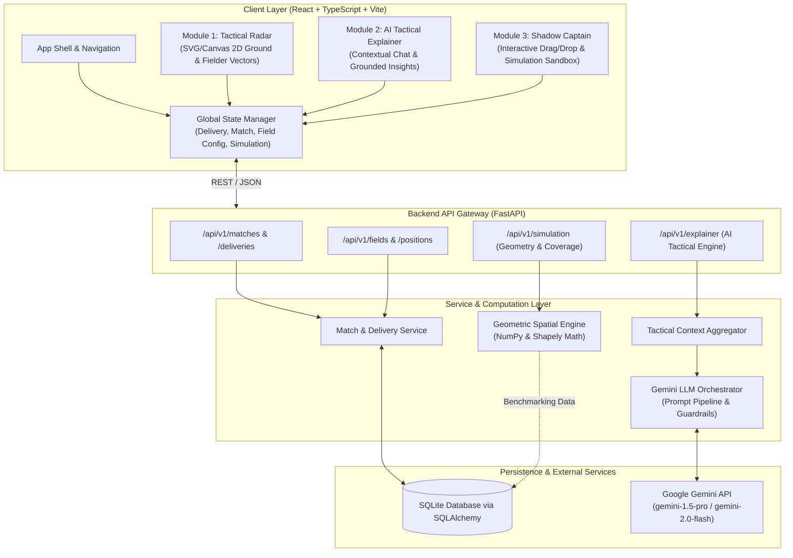
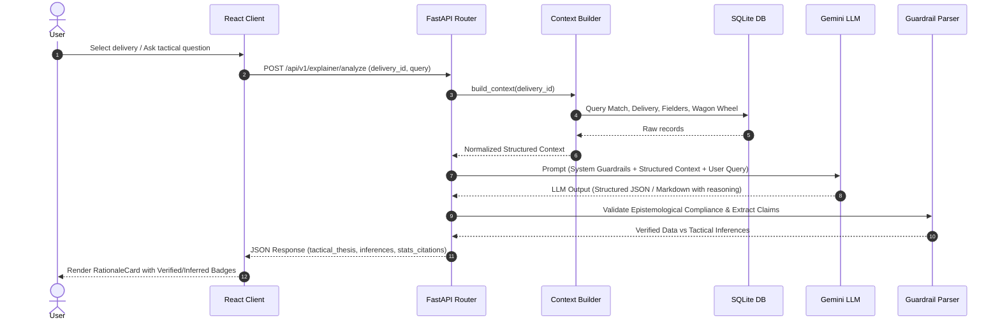
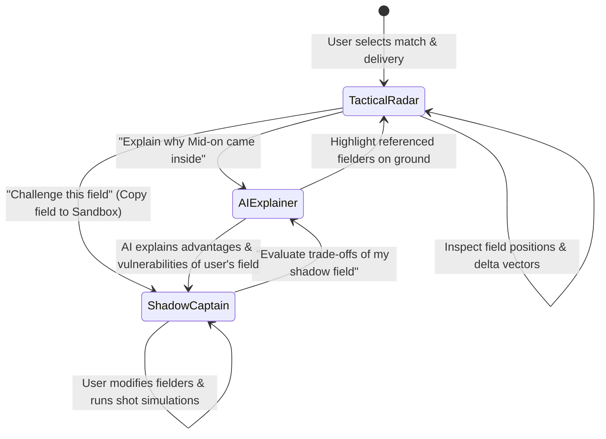

# DugoutAI — System Architecture

---

## 1. High-Level Architecture Overview

DugoutAI is structured as a decoupled, modern multi-tier web application composed of a high-performance interactive client, an asynchronous Python API backend, an intelligent LLM synthesis service (Gemini), and a geometric spatial simulation engine (NumPy + Shapely).



---

## 2. Frontend Architecture (React + TypeScript + Vite)

### 2.1 Core Technology Choices
- **React 18 / 19 & TypeScript:** Type safety for spatial coordinates, match metadata, and simulation results.
- **Vite:** High-speed development server, optimized ESM bundling, and fast HMR.
- **Tailwind CSS:** Responsive tactical dashboard UI with a dark sports-analytics color palette (slate, emerald, amber, crimson).
- **Lucide React:** Lightweight, clear tactical and interface iconography.
- **Recharts:** Statistical breakdowns (run rate charts, wagon wheels, boundary probability histograms).

### 2.2 Coordinate System & 2D Cricket Ground Renderer

The cricket field is rendered using a normalized coordinate system mapped onto a responsive SVG or HTML5 Canvas viewport.

```
                  (-1.0, 1.0)       [Straight Boundary]      (1.0, 1.0)
                                            ^ +Y
                                            |
                      .---------------------+---------------------.
                    /                       |                       \
                   /         .--------------+--------------.         \
                  /         /               |               \         \
                 /         /          Non-Striker            \         \
                |         |                 |                 |         |
      -X <------+---------+--------- [Pitch Center] ----------+---------+------> +X
     [Off Side] |         |                 |                 |         | [Leg Side]
    (for RHB)   \         \              Striker              /         /
                 \         \                |                /         /
                  \         '---------------+---------------'         /
                   \                        |                        /
                    '-----------------------+-----------------------'
                                            | -Y
                  (-1.0, -1.0)      [Behind Keeper]         (1.0, -1.0)
```

#### Coordinate Normalization Standards:
1. **Origin $(0, 0)$:** The center of the cricket pitch (or striker's crease, with selectable toggle).
2. **Normalized Radius $[-1.0, +1.0]$:**
   - Center to Boundary Rope: Normalized distance $R_{\text{boundary}} = 1.0$ (typically $65\text{m}-85\text{m}$ in physical ground specs).
   - 30-Yard Circle ($27.43\text{m}$): Normalized distance $R_{\text{circle}} \approx 0.40 - 0.45$.
   - Pitch Dimensions: Length $20.12\text{m}$ ($22\text{ yards}$), Width $3.05\text{m}$ ($10\text{ feet}$).
3. **Polar and Cartesian Interop:**
   - Fielders can be specified as $(x, y) \in [-1.0, 1.0]^2$ or $(\theta, r)$ where $\theta \in [0^\circ, 360^\circ)$ and $r \in [0.0, 1.0]$.
   - Handedness Transformation: For Left-Handed Batters (LHB), the $X$-axis can be inverted or dynamically labeled so off-side and leg-side remain tactically consistent.

### 2.3 Frontend Component Hierarchy
```
src/
├── components/
│   ├── ground/
│   │   ├── CricketGroundCanvas.tsx     # SVG/Canvas ground (pitch, circle, boundary)
│   │   ├── FielderNode.tsx             # Interactive fielder circle, label, drag handle
│   │   ├── ShiftVectorArrow.tsx        # Dynamic SVG animated vector showing delta movement
│   │   ├── CoverageHeatmapOverlay.tsx  # Canvas layer rendering Shapely coverage polygons
│   │   └── ShotTrajectoryArc.tsx       # Trajectory path for simulated/actual shots
│   ├── radar/
│   │   ├── DeliveryTimeline.tsx        # Ball-by-ball scrub bar with event markers
│   │   ├── DeliveryDetailCard.tsx      # Match phase, speed, line, length, batter/bowler
│   │   ├── FielderInfoDrawer.tsx       # Bio, fielding skills, catch conversion, radar notes
│   │   └── RadarComparisonView.tsx     # Side-by-side or ghosted previous ball overlay
│   ├── explainer/
│   │   ├── TacticalDialogue.tsx        # Conversational Q&A interface
│   │   ├── RationaleCard.tsx           # Auto-generated tactical thesis for current field
│   │   ├── EvidenceChips.tsx           # Verified stats vs tactical inference tags
│   │   └── PromptSuggestionPills.tsx   # Pre-formulated high-value tactical queries
│   ├── shadow/
│   │   ├── SandboxControls.tsx         # Shot scenario picker, format selector, reset
│   │   ├── RuleComplianceBadge.tsx     # Live validation: Powerplay & Leg-side rules
│   │   ├── MetricComparisonBar.tsx     # Protected % vs Exposed % vs Risk Score
│   │   └── TradeOffDrawer.tsx          # AI trade-off evaluation summary
│   └── common/
│       ├── Header.tsx                  # Brand, match selector, theme
│       ├── Tabs.tsx                    # Seamless switching between Radar, Explainer, Shadow
│       └── Badge.tsx                   # Status, role, and verification indicators
├── hooks/
│   ├── useMatchData.ts                 # Fetch & cache match, deliveries, field positions
│   ├── useFieldDrag.ts                 # Handles SVG/Canvas drag-and-drop math & bounding
│   ├── useSimulation.ts                # Calls backend spatial engine with debounce
│   └── useTacticalAI.ts                # Manages streaming or synchronous AI explainer chat
├── types/
│   ├── cricket.ts                      # Match, Delivery, Player, Position types
│   ├── simulation.ts                   # ShotScenario, CoverageResult, FieldRuleViolation
│   └── explainer.ts                    # AIRequest, AIExplanation, EpistemicTag
└── store/
    └── tacticalStore.ts                # Zustand global state
```

---

## 3. Backend Architecture (FastAPI + Python)

### 3.1 Framework & Pattern
- **FastAPI:** Asynchronous routing, built-in Pydantic v2 data validation, OpenAPI autodoc generation, high throughput.
- **Architecture Pattern:** Clean Onion / Hexagonal Architecture:
  - **Routers (Web/API Layer):** HTTP request parsing, status codes, query validation.
  - **Services (Business Logic):** Match coordination, AI prompt synthesis, simulation orchestration.
  - **Domain / Models:** Domain entities, Pydantic schemas, geometric primitives.
  - **Repositories (Data Access):** SQLAlchemy ORM querying SQLite database.

### 3.2 Directory Structure
```
backend/
├── app/
│   ├── api/
│   │   ├── v1/
│   │   │   ├── api.py                  # API router aggregator
│   │   │   ├── endpoints/
│   │   │   │   ├── matches.py          # /matches, /matches/{id}
│   │   │   │   ├── deliveries.py       # /matches/{id}/deliveries/{ball_id}
│   │   │   │   ├── explainer.py        # /explainer/analyze, /explainer/chat
│   │   │   │   └── simulation.py       # /simulation/evaluate, /simulation/compare
│   ├── core/
│   │   ├── config.py                   # Pydantic BaseSettings, API keys, CORS
│   │   └── logging.py                  # Structured application logging
│   ├── db/
│   │   ├── base.py                     # SQLAlchemy Base
│   │   ├── session.py                  # Async/sync engine and sessionmaker
│   │   └── init_db.py                  # Initial schema setup and seed runner
│   ├── models/                         # SQLAlchemy ORM models
│   │   ├── match.py
│   │   ├── player.py
│   │   ├── delivery.py
│   │   └── fielder_position.py
│   ├── schemas/                        # Pydantic request/response schemas
│   │   ├── match.py
│   │   ├── delivery.py
│   │   ├── field.py
│   │   ├── explainer.py
│   │   └── simulation.py
│   ├── services/
│   │   ├── match_service.py            # Queries deliveries and field deltas
│   │   ├── tactical_context_builder.py # Gathers data for AI prompt
│   │   ├── gemini_service.py           # Gemini API client with safety & grounding
│   │   └── simulation_engine.py        # Shapely + NumPy geometric coverage engine
│   └── utils/
│       ├── cricket_rules.py            # Powerplay & boundary legal checks
│       └── coordinate_math.py          # Polar <-> Cartesian, meters <-> normalized
├── tests/
│   ├── test_simulation.py              # Geometric coverage & boundary intersection tests
│   ├── test_rules.py                   # Field restriction enforcement tests
│   └── test_api.py                     # Endpoint contract tests
├── seed_data/                          # Real/curated ball-by-ball matches with full fields
│   └── t20_match_01.json
├── requirements.txt
└── main.py                             # ASGI entrypoint
```

---

## 4. AI Orchestration & Epistemological Guardrail Layer

### 4.1 Gemini API Integration
The system integrates Google Gemini (e.g., `gemini-1.5-pro` or `gemini-2.0-flash` depending on latency requirements) via the official Google GenAI SDK. API keys are sourced strictly from environment variables (`GEMINI_API_KEY`).

### 4.2 Structured Context Retrieval Pipeline
Before dispatching a prompt to Gemini, the backend's `TacticalContextBuilder` constructs a deterministic context payload:
1. **Match Snapshot:** Format, inning, over, ball, score, wickets, required run rate, target.
2. **Duel Dynamics:**
   - Batter Profile: Name, batting stance (LHB/RHB), recent form, strike rate against this bowling type, wagon wheel quadrant distribution.
   - Bowler Profile: Name, bowling arm & style (e.g., Right-arm Fast, Left-arm Orthodox), line/length plan.
3. **Spatial Configuration:**
   - Current 9 fielders with standardized position names and $(x, y)$ polar sectors.
   - Previous delivery's field (if different), detailing specific displacements (e.g., *"Mid-on moved back to long-on; third slip removed for deep backward point"*).
4. **Recent Delivery Sequence:** Outcomes of the last 6 balls (e.g., `[4, 0, 6, 1, 0, W]`).



### 4.3 Epistemological Guardrails
To prevent hallucinated intentionality and uphold tactical credibility:
- **System Instruction Directives:**
  - *"You are DugoutAI's tactical analyst. Explain plausible tactical logic based on cricket orthodoxy, field angles, and matchup statistics."*
  - *"NEVER claim to know what the captain or bowler 'thought' or 'intended' unless citing explicit post-match interviews or recorded commentary."*
  - *"Phrasing must use probabilistic tactical language: 'This placement appears designed to...', 'Orthodox theory suggests...', 'Statistically, against this bowler's outswinger...'"*
  - *"Structure responses into two distinct fields: `verified_facts` (runs, scores, player records, exact coordinates) and `tactical_interpretations` (hypotheses, intended traps, risk considerations)."*

---

## 5. Geometric Simulation Engine (NumPy + Shapely)

### 5.1 Physical Cricket Ground Modeling
The ground is represented as a 2D Euclidean coordinate space bounded by an elliptical polygon:
$$\frac{x^2}{a^2} + \frac{y^2}{b^2} \le 1.0$$
where $a, b$ represent straight and square boundary radii in meters (e.g., $a = 75\text{m}, b = 68\text{m}$).

### 5.2 Fielder Interception Polygon Synthesis
Each fielder $i$ positioned at $\mathbf{p}_i = (x_i, y_i)$ can cover a dynamic spatial catchment zone determined by ball travel time $t$:
$$R_{\text{reach}}(t) = \max\left(0, (t - t_{\text{reaction}}) \cdot v_{\text{sprint}} + r_{\text{dive}}\right)$$
- $t_{\text{reaction}} \approx 0.35\text{ seconds}$
- $v_{\text{sprint}} \approx 6.0\text{ m/s}$ average acceleration ramp-up
- $r_{\text{dive}} \approx 1.75\text{ meters}$

Using **Shapely** and **NumPy**:
1. **Ray-Casting Interception:** For any shot angle $\theta \in [0, 360^\circ)$ and exit velocity $v_{\text{shot}}$, DugoutAI calculates the time $t_{\text{boundary}}$ for the ball to reach the boundary rope.
2. **Fielder Time-to-Intercept:** Computes whether any fielder $i$ can reach the ball trajectory line before $t_{\text{boundary}}$.
3. **Interception Voronoi / Buffer Union:** Generates polygons representing covered ground vs exposed boundary gaps.

```mermaid
flowchart LR
    A[Fielder Positions (x, y)] --> B[Shapely Geometric Model]
    C[Shot Scenario (Angle, Speed, Loft)] --> B
    D[Ground Geometry (Boundary & 30-yd ring)] --> B
    B --> E[Vector Interception Math]
    E --> F[Exposed Angle Cones]
    E --> G[Interception Catchment Polygons]
    F & G --> H[Coverage Metrics: Protected %, Exposed %, Boundary Risk]
```

---

## 6. Data Flow Between the Three Modules

The three modules are designed as mutually reinforcing tactical workflows:



1. **Radar $\to$ Explainer:** User clicks any delivery or fielder in the Tactical Radar $\to$ the AI Explainer opens with the full context pre-loaded, explaining the placement.
2. **Radar $\to$ Shadow Captain:** With one click (*"Edit in Shadow Captain"*), the active delivery's 9 fielders are cloned into the sandbox as the baseline.
3. **Shadow Captain $\to$ AI Explainer:** After dragging fielders and generating spatial coverage metrics, the user clicks *"Ask AI to Critique"*. The AI compares the baseline field with the shadow field and breaks down tactical gains vs exposed risks.

---

## 7. Technology Stack Summary

| Layer | Technology | Key Libraries / Frameworks | Purpose |
| :--- | :--- | :--- | :--- |
| **Frontend** | TypeScript / React | Vite, Tailwind CSS, Lucide React, Recharts | Interactive UI, 2D Ground rendering, state management |
| **Backend** | Python 3.10+ | FastAPI, Pydantic v2, Uvicorn | High-speed REST API, schema validation, async services |
| **Persistence** | SQLite / SQLAlchemy | SQLAlchemy 2.0 (ORM) | Lightweight, zero-config relational store for matches, deliveries, and field coordinates |
| **AI Reasoning**| Google Gemini | `google-genai` SDK | Strategic interpretation, match context synthesis, guardrail enforcement |
| **Simulation** | Python | NumPy, Shapely, SciPy | Spatial geometry, polygon clipping, ray casting, coverage heatmaps |

