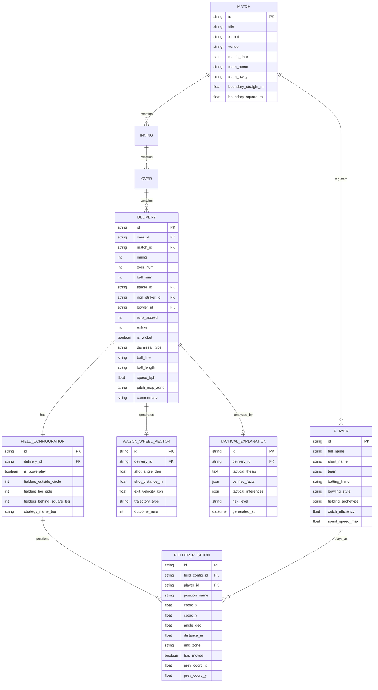

# DugoutAI — Database Schema & Data Models

---

## 1. Schema Overview & Design Principles

The DugoutAI database is designed to capture high-resolution ball-by-ball spatial and tactical state. While traditional cricket databases capture only scorecard aggregates or basic ball-by-ball text, DugoutAI requires **fielder positional coordinates for every delivery**, associated wagon wheel vectors, match context, and pre-computed or cached AI tactical analyses.

### Design Principles:
1. **Relational Integrity:** Strong foreign-key constraints between matches, overs, deliveries, and fielder coordinates.
2. **Normalized 2D Coordinates:** Fielder positions are stored in both normalized Cartesian coordinates $(x, y) \in [-1.0, 1.0]^2$ and Polar coordinates $(\theta^\circ, r_{\text{meters}})$.
3. **Change Tracking (Deltas):** Fast lookup for whether a fielder shifted between delivery $(N-1)$ and $N$, including previous coordinate references for zero-latency UI vector animations.
4. **Epistemic Cleanliness:** Distinct columns/tables for ground truth (official scorecards, HawkEye/ball tracking line and length) versus tactical interpretations.

---

## 2. Entity-Relationship Diagram (ERD)

---

## 3. Table Specifications & Data Dictionaries

### 3.1 `matches`
Stores high-level fixture metadata and ground dimensions for scaling coordinate systems.

| Column | Type | Constraints | Description |
| :--- | :--- | :--- | :--- |
| `id` | `VARCHAR(36)` | PRIMARY KEY | Unique match identifier (UUID or slug like `t20-ind-pak-2024-m19`) |
| `title` | `VARCHAR(128)` | NOT NULL | Human-readable fixture title |
| `series` | `VARCHAR(128)` | NOT NULL | Tournament / Series name |
| `format` | `VARCHAR(16)` | NOT NULL | Match format: `'T20'`, `'ODI'`, `'TEST'` |
| `venue` | `VARCHAR(128)` | NOT NULL | Stadium name and city |
| `match_date` | `DATE` | NOT NULL | Date fixture was played |
| `team_home` | `VARCHAR(64)` | NOT NULL | Home team identifier / name |
| `team_away` | `VARCHAR(64)` | NOT NULL | Away team identifier / name |
| `toss_winner` | `VARCHAR(64)` | NOT NULL | Team that won toss |
| `toss_decision` | `VARCHAR(16)` | NOT NULL | `'bat'` or `'field'` |
| `winner` | `VARCHAR(64)` | NULLABLE | Winning team or `'tie'` / `'no_result'` |
| `target_runs` | `INTEGER` | NULLABLE | Target runs in 2nd innings |
| `boundary_straight_m` | `FLOAT` | DEFAULT 75.0 | Ground radius straight down ground (meters) |
| `boundary_square_m` | `FLOAT` | DEFAULT 68.0 | Ground radius square of wicket (meters) |
| `created_at` | `DATETIME` | DEFAULT CURRENT_TIMESTAMP | Record creation timestamp |

---

### 3.2 `players`
Player profiles including physiological and fielding attributes utilized by the simulation engine.

| Column | Type | Constraints | Description |
| :--- | :--- | :--- | :--- |
| `id` | `VARCHAR(36)` | PRIMARY KEY | Unique player ID |
| `full_name` | `VARCHAR(128)` | NOT NULL | Complete legal name |
| `short_name` | `VARCHAR(64)` | NOT NULL | Scorecard name (e.g. `'V. Kohli'`) |
| `team` | `VARCHAR(64)` | NOT NULL | Team identifier |
| `batting_hand` | `VARCHAR(8)` | NOT NULL | `'RHB'` (Right-hand) or `'LHB'` (Left-hand) |
| `bowling_style` | `VARCHAR(64)` | NOT NULL | e.g. `'Right-arm Fast'`, `'Slow Left-arm Orthodox'` |
| `is_wicketkeeper` | `BOOLEAN` | DEFAULT 0 | Regular wicketkeeper designation |
| `fielding_archetype`| `VARCHAR(32)` | DEFAULT 'General' | `'Slip Cordon'`, `'Ring Specialist'`, `'Boundary Sweeper'`, `'Hotspot'` |
| `catch_efficiency` | `FLOAT` | DEFAULT 0.82 | Statistical catch success rate ($0.0 - 1.0$) |
| `sprint_speed_max` | `FLOAT` | DEFAULT 8.2 | Peak sprint speed in $\text{m/s}$ (used in coverage engine) |
| `reaction_time_sec`| `FLOAT` | DEFAULT 0.35 | Anticipation reaction time in seconds |

---

### 3.3 `deliveries`
Detailed ball-by-ball record capturing duel context, ball tracking metrics, and scoring.

| Column | Type | Constraints | Description |
| :--- | :--- | :--- | :--- |
| `id` | `VARCHAR(64)` | PRIMARY KEY | Unique delivery ID (`{match_id}_{inn}_{over}_{ball}`) |
| `match_id` | `VARCHAR(36)` | FOREIGN KEY (`matches.id`) | Reference to parent match |
| `inning` | `INTEGER` | NOT NULL | $1$ or $2$ (or $3, 4$ for Tests) |
| `over_num` | `INTEGER` | NOT NULL | $0$-indexed or $1$-indexed over number |
| `ball_num` | `INTEGER` | NOT NULL | Ball number within the over |
| `legal_ball_num` | `INTEGER` | NOT NULL | Legal ball counter |
| `striker_id` | `VARCHAR(36)` | FOREIGN KEY (`players.id`) | Batter facing delivery |
| `non_striker_id` | `VARCHAR(36)` | FOREIGN KEY (`players.id`) | Non-striking batter |
| `bowler_id` | `VARCHAR(36)` | FOREIGN KEY (`players.id`) | Bowler delivering ball |
| `runs_batter` | `INTEGER` | DEFAULT 0 | Runs scored off bat |
| `runs_extras` | `INTEGER` | DEFAULT 0 | Extra runs (wides, no-balls, byes, leg-byes) |
| `extra_type` | `VARCHAR(16)` | NULLABLE | `'wide'`, `'no_ball'`, `'bye'`, `'leg_bye'`, `'penalty'` |
| `is_wicket` | `BOOLEAN` | DEFAULT 0 | Did a dismissal occur? |
| `dismissal_type` | `VARCHAR(32)` | NULLABLE | `'bowled'`, `'caught'`, `'lbw'`, `'run_out'`, `'stumped'` |
| `dismissed_player_id`| `VARCHAR(36)`| NULLABLE | ID of dismissed player |
| `ball_line` | `VARCHAR(32)` | NULLABLE | `'outside_off'`, `'stumps'`, `'down_leg'`, `'wide_outside_off'` |
| `ball_length` | `VARCHAR(32)` | NULLABLE | `'yorker'`, `'full'`, `'good_length'`, `'short_of_length'`, `'short'` |
| `speed_kph` | `FLOAT` | NULLABLE | Delivery speed at release in $\text{km/h}$ |
| `pitch_map_x` | `FLOAT` | NULLABLE | Lateral bounce point on pitch (meters from center line) |
| `pitch_map_y` | `FLOAT` | NULLABLE | Longitudinal bounce point (meters from batting stumps) |
| `commentary` | `TEXT` | NULLABLE | Live ball-by-ball commentary snippet |

---

### 3.4 `field_configurations`
High-level summary of the fielding setup deployed for a specific delivery.

| Column | Type | Constraints | Description |
| :--- | :--- | :--- | :--- |
| `id` | `VARCHAR(64)` | PRIMARY KEY | Unique configuration ID |
| `delivery_id` | `VARCHAR(64)` | FOREIGN KEY (`deliveries.id`) | Target delivery |
| `match_id` | `VARCHAR(36)` | FOREIGN KEY (`matches.id`) | Denormalized match reference |
| `is_powerplay` | `BOOLEAN` | DEFAULT 0 | Flag indicating active field restriction phase |
| `outside_circle_count` | `INTEGER` | NOT NULL | Count of fielders beyond 30-yard ring (must be $\le 2$ in T20 PP, $\le 5$ in non-PP) |
| `leg_side_count` | `INTEGER` | NOT NULL | Count of fielders on leg side (must be $\le 5$) |
| `behind_square_leg_count` | `INTEGER`| NOT NULL | Count of fielders behind square leg (must be $\le 2$) |
| `strategy_label` | `VARCHAR(64)` | NULLABLE | Tactical taxonomy (e.g. `'Death Yorker Shield (6-3 Off)'`) |

---

### 3.5 `fielder_positions`
Spatial coordinates and metadata for each of the 9 active fielders (plus wicketkeeper & bowler stance).

| Column | Type | Constraints | Description |
| :--- | :--- | :--- | :--- |
| `id` | `VARCHAR(64)` | PRIMARY KEY | Unique position record ID |
| `field_config_id` | `VARCHAR(64)` | FOREIGN KEY (`field_configurations.id`) | Parent configuration |
| `player_id` | `VARCHAR(36)` | FOREIGN KEY (`players.id`) | Fielder stationed at this spot |
| `position_name` | `VARCHAR(64)` | NOT NULL | Standard cricket label (e.g. `'Deep Backward Point'`) |
| `coord_x` | `FLOAT` | NOT NULL | Normalized $X \in [-1.0, 1.0]$ (Off-side negative, Leg-side positive for RHB) |
| `coord_y` | `FLOAT` | NOT NULL | Normalized $Y \in [-1.0, 1.0]$ (Straight positive, Behind stumps negative) |
| `angle_deg` | `FLOAT` | NOT NULL | Polar angle in degrees ($0^\circ = \text{straight behind bowler}, 90^\circ = \text{square leg}, \dots$) |
| `distance_m` | `FLOAT` | NOT NULL | Distance in physical meters from striker's stumps |
| `ring_zone` | `VARCHAR(24)` | NOT NULL | `'close_in'`, `'inner_ring'`, `'outfield'` |
| `has_moved` | `BOOLEAN` | DEFAULT 0 | Indicates if this fielder shifted compared to the preceding ball |
| `prev_coord_x` | `FLOAT` | NULLABLE | Previous normalized $X$ (for vector animations) |
| `prev_coord_y` | `FLOAT` | NULLABLE | Previous normalized $Y$ (for vector animations) |

---

### 3.6 `wagon_wheel_vectors`
Shot tracking trajectory data for evaluating interception and coverage.

| Column | Type | Constraints | Description |
| :--- | :--- | :--- | :--- |
| `id` | `VARCHAR(64)` | PRIMARY KEY | Unique vector ID |
| `delivery_id` | `VARCHAR(64)` | FOREIGN KEY (`deliveries.id`) | Associated delivery |
| `shot_angle_deg` | `FLOAT` | NOT NULL | Angle of the shot off the bat ($0^\circ - 360^\circ$) |
| `shot_distance_m` | `FLOAT` | NOT NULL | Total landing/boundary distance |
| `exit_velocity_kph`| `FLOAT` | NOT NULL | Initial ball velocity off bat |
| `trajectory_type` | `VARCHAR(16)` | NOT NULL | `'ground'`, `'aerial_low'`, `'lofted_high'` |
| `outcome_runs` | `INTEGER` | NOT NULL | Actual runs scored |

---

### 3.7 `tactical_explanations`
Structured tactical interpretations cached or generated by the Gemini engine.

| Column | Type | Constraints | Description |
| :--- | :--- | :--- | :--- |
| `id` | `VARCHAR(64)` | PRIMARY KEY | Unique explanation ID |
| `delivery_id` | `VARCHAR(64)` | FOREIGN KEY (`deliveries.id`) | Delivery analyzed |
| `tactical_thesis` | `TEXT` | NOT NULL | High-level 2-3 sentence strategic rationale |
| `verified_facts` | `JSON` | NOT NULL | Structured array of verified stats cited |
| `tactical_inferences`| `JSON` | NOT NULL | Structured array of inferred tactical plans |
| `risk_considerations`| `JSON` | NOT NULL | Evaluated vulnerabilities of this placement |
| `model_version` | `VARCHAR(32)` | NOT NULL | Gemini model version used |
| `created_at` | `DATETIME` | DEFAULT CURRENT_TIMESTAMP | Timestamp of synthesis |

---

## 4. Indexing & Query Optimization Strategy

To guarantee sub-$20\text{ms}$ latency when scrubbing through deliveries in the Tactical Radar:
1. **`idx_deliveries_match_over_ball`** on `deliveries(match_id, inning, over_num, ball_num)`
2. **`idx_fielder_positions_config`** on `fielder_positions(field_config_id)`
3. **`idx_field_config_delivery`** on `field_configurations(delivery_id)`
4. **`idx_wagon_wheel_delivery`** on `wagon_wheel_vectors(delivery_id)`

---

## 5. Seed Data Strategy

DugoutAI includes high-fidelity seed datasets replicating critical tactical inflection overs from premier matches:
- **Case Study 1: The Death-Over Squeeze (T20):**
  - Overs 18 to 20 of a high-pressure chase.
  - Demonstrates shifts from 5-4 off-side heavy boundary protection to wide-yorker traps with third man squarer.
- **Case Study 2: The Powerplay Trap (T20):**
  - Overs 1 to 4 with swing bowler targeting outside edge.
  - Illustrates fly slip, catching cover, and short mid-wicket transitions.
- **Case Study 3: The Spin Choke (Middle Overs):**
  - Leg-spinner versus left-hander: deep point pushed back to sweeper, long-off brought to straight mid-off inside the circle.

