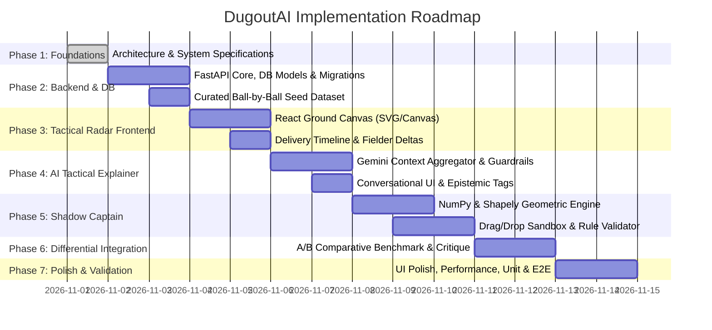

# DugoutAI — Phased Development Roadmap & Risk Analysis

---

## 1. Phased Development Roadmap

---

## 2. Phase Breakdown & Deliverables

### Phase 1: Architecture & Technical Foundations (Current)
- [x] Establish product identity, problem statement, and core values.
- [x] Map out comprehensive multi-tier architecture and modular data flow.
- [x] Detail relational database schema, indexes, and normalization models.
- [x] Author OpenAPI REST endpoint contracts and RFC 7807 error specifications.
- [x] Formulate mathematical ground geometry, fielder kinematics, and Shapely ray-casting algorithms.
- [x] Define phased milestones and technical risk mitigations.

### Phase 2: Backend Core, Data Models & High-Resolution Seed Data
- **Objective:** Establish the FastAPI server, SQLite database, and seed realistic ball-by-ball datasets with 11-player tracking.
- **Key Tasks:**
  - Initialize FastAPI project structure with CORS, settings, and logging.
  - Implement SQLAlchemy ORM models (`Match`, `Player`, `Delivery`, `FieldConfiguration`, `FielderPosition`, `WagonWheelVector`).
  - Create database migration/initialization scripts (`init_db.py`).
  - Author high-resolution seed data: Curate full-field coordinates for crucial overs from iconic fixtures (e.g. India vs Pakistan T20 World Cup 2024 death over thriller, 2023 World Cup final bowling traps).
  - Verify endpoints for `/matches`, `/deliveries`, and `/deliveries/{id}/field`.

### Phase 3: Tactical Radar & 2D Ground Canvas (Frontend)
- **Objective:** Build an interactive 2D cricket ground rendering the complete field setting with animations.
- **Key Tasks:**
  - Setup React + TypeScript + Vite + Tailwind CSS frontend.
  - Build `CricketGroundCanvas`: SVG-based cricket ground with pitch, creases, 30-yard circle, and boundary rope.
  - Implement `FielderNode`: Draggable, labeled circular player markers with role indicators.
  - Build `DeliveryTimeline`: Ball-by-ball scrub bar with event badges (wickets, boundaries, dots).
  - Implement `ShiftVectorArrow`: SVG animated displacement vectors connecting previous fielder coordinates $(x_{t-1}, y_{t-1})$ to current $(x_t, y_t)$.
  - Create `FielderInfoDrawer`: Slide-over card displaying player fielding ratings, archetype, and tactical position history.

### Phase 4: Gemini AI Tactical Explainer
- **Objective:** Deploy context-grounded AI tactical reasoning with strict epistemological guardrails.
- **Key Tasks:**
  - Build backend `TacticalContextBuilder` to assemble match score, batter/bowler dynamics, pitch tendencies, and spatial coordinates into a structured prompt.
  - Integrate official Google GenAI SDK (`gemini-1.5-pro` or `gemini-2.0-flash`) using `GEMINI_API_KEY`.
  - Enforce system prompts with epistemic rules:
    - Never assume captain's internal thoughts without evidence.
    - Demarcate `verified_facts` from `tactical_inferences`.
  - Build frontend `TacticalDialogue`: Clean chat interface with evidence tags, tactical rationale cards, and follow-up chips.

### Phase 5: Geometry Simulation Engine & Shadow Captain Sandbox (Completed)
- [x] Implement `geometry_engine.py` using NumPy and Shapely:
  - Ground polygon boundary ellipse and sector wedges.
  - Euclidean reachability grid evaluation: $t_{\text{f}} = t_{\text{react}} + \frac{d(F, P)}{v_{\text{f}}}$ vs $t_{\text{b}} = \frac{d(\text{Batter}, P)}{v_{\text{b}}}$.
  - Double-counting prevention using union of reachability.
  - Multi-scenario shot corridors (Cover, Extra Cover, Mid-off, Midwicket).
  - Primary target corridor + adjacent zone coverage breakdown.
- [x] Build frontend `ShadowCaptain` sandbox:
  - Drag-and-drop pointer tracking with coordinate inversion and boundary bounds.
  - Interactive scenario selector cards.
  - Configurable physics assumptions sliders (reaction time, sprint speed, ball speed, grid density).
  - Reachability coverage heatmaps with green covered points and red exposed points.
  - Multi-view display modes: Custom, Original, Difference (ghosted positions + vector lines).
  - Stale detection on fielder repositioning.

### Phase 6: Differential Benchmarking & AI Trade-Off Critique (Completed)
- [x] Implement `POST /api/simulator/evaluate` endpoint returning deterministic coverage metrics.
- [x] Implement `POST /api/simulator/explain-tradeoffs` combining deterministic deltas with Gemini 2.5 Pro critique.
- [x] Build frontend `TradeOffModal` displaying structured critique: Summary, Gained Coverage, Exposed Corridors, Optimal Match Context, and Epistemological Grounding disclaimer.

### Phase 7: Polish, Verification & Packaging
- **Objective:** Ensure rock-solid stability, aesthetic excellence, and end-to-end responsiveness.
- **Key Tasks:**
  - Responsive design optimization for desktop and tablet screens.
  - Unit tests for spatial geometry, boundary collision, and rule validation.
  - End-to-end smoke testing across the full user loop (Radar $\to$ Explainer $\to$ Shadow $\to$ Critique).
  - Documentation finalize and launch checklist.

---

## 3. Potential Technical Risks & Mitigation Strategies

| Risk Category | Specific Technical Risk | Impact | Mitigation Strategy |
| :--- | :--- | :--- | :--- |
| **Spatial Math & Coordinate Alignment** | Discrepancies between frontend SVG canvas coordinates $(X, Y)$ and backend Shapely Euclidean meters $(x_{\text{m}}, y_{\text{m}})$. | High | Establish a single source of truth for normalized coordinates $[-1.0, 1.0]^2$. Build a shared conversion utility `coordinate_math.py` and `coordinateMath.ts` with identical unit test suites. |
| **Simulation Latency** | Computing 720-ray boundary intersections across 9 fielders on every drag event causing UI stutter. | Medium | 1. Debounce drag events ($250\text{ms}$). 2. Vectorize the ray-projection math using NumPy matrix broadcasting. 3. Cache static boundary intersection distances $D_{\text{boundary}}(\theta)$ in memory. |
| **LLM Epistemic Drift** | Gemini claiming *"Rohit Sharma wanted to tempt the batter"* (claiming unverified mind-reading). | High | 1. Strict system prompt boundary instructions. 2. JSON response schema enforcing separate `verified_facts` and `tactical_inferences` keys. 3. Client-side disclaimer banner on all AI interpretations. |
| **Cricket Rule Edge Cases** | Handling rare fielding restrictions (e.g., Free Hit field freezing, concussion substitute shifts). | Low | Model standard T20/ODI rules cleanly first (Powerplay ring limit, leg-side limit, behind-square-leg limit). Isolate rule engine in `cricket_rules.py` for modular testability. |
| **Fielder Drag Touch UX** | Dragging small fielder markers on touchscreens or dense clusters (e.g. 3 slips) being clumsy. | Medium | Implement visual clustering / separation offsets when markers are within $0.05$ normalized distance; provide enlarged touch target radii ($44\text{px}$) and coordinate input fine-tuners. |

---

## 4. Verification & Testing Matrix

| Component | Test Scope | Tooling |
| :--- | :--- | :--- |
| **Backend API** | Endpoint status codes, request validation, error models | `pytest`, `httpx`, `FastAPI TestClient` |
| **Simulation Engine** | Ray-casting accuracy, boundary intersection math, sprint physics | `pytest`, `numpy.testing`, `shapely` asserts |
| **Cricket Rules** | Powerplay boundaries, leg-side counts, behind-square limits | Unit test suite with parameterized test cases |
| **AI Explainer** | Context assembly, prompt formatting, JSON parser safety | Mock LLM responses, Pydantic schema validation |
| **Frontend UI** | Ground canvas rendering, drag constraints, timeline scrub | Vitest, React Testing Library |

