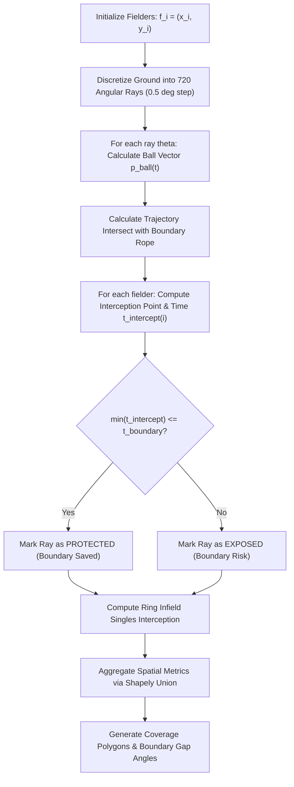

# DugoutAI — Geometric Simulation Engine Methodology

---

## 1. Mathematical Ground Modeling

The cricket ground is modeled in a 2D Euclidean coordinate system $(x, y)$ with origin $(0, 0)$ located at the center of the pitch.

```
                      Y (Straight / Bowler's End)
                               ^
                               |
                      .--------+--------.
                    /          |          \
                   /     .-----+-----.     \
                  /     /      |      \     \
                 /     /   [Non-Striker] \   \
                |     |        |        |     |
      -X <------+-----+----+---+----+---+-----+------> +X
     (Off Side) |     |        |        |     | (Leg Side)
                \     \    [Striker]    /     /
                 \     \       |       /     /
                  \     '------+------'     /
                   \           |           /
                    '----------+----------'
                               |
                               v
                     -Y (Fine / Wicketkeeper's End)
```

### 1.1 Ground Elements & Physical Dimensions

1. **Pitch Geometry:**
   - Length: $L_{\text{pitch}} = 20.12\text{ m}$ ($22\text{ yards}$).
   - Width: $W_{\text{pitch}} = 3.05\text{ m}$ ($10\text{ feet}$).
   - Stumps: Batting stumps at $(0, -10.06)$, Bowling stumps at $(0, +10.06)$.
   - Batting Crease: $1.22\text{ m}$ ($4\text{ feet}$) forward of batting stumps: $y = -8.84\text{ m}$.

2. **The 30-Yard Infield Circle ($27.43\text{ m}$):**
   - Modeled in standard ICC regulations as two semicircles of radius $R_{\text{infield}} = 27.43\text{ m}$ centered on the batting and bowling stumps, connected by parallel straight tangent segments:
     - Semicircle 1 (Batting end): Center $(0, -10.06)$, radius $27.43\text{ m}$ for $y \le -10.06$.
     - Semicircle 2 (Bowling end): Center $(0, +10.06)$, radius $27.43\text{ m}$ for $y \ge +10.06$.
     - Infield Polygon: $\mathcal{P}_{\text{infield}}$ constructed via `shapely.geometry.Polygon`.

3. **Boundary Rope (Elliptical Polygon):**
   - Parameterized by semi-major axis $a$ (straight radius, typically $75.0\text{ m}$) and semi-minor axis $b$ (square radius, typically $68.0\text{ m}$):
     $$\frac{x^2}{b^2} + \frac{y^2}{a^2} \le 1.0$$
   - Boundary Polygon: $\mathcal{P}_{\text{boundary}}$ discretized into $720$ vertices.

---

## 2. Ball Kinematics & Shot Trajectory Modeling

A shot leaves the bat at the striker's crease $\mathbf{p}_{\text{origin}} = (0, -8.84)$ with polar angle $\theta \in [0^\circ, 360^\circ)$ and exit velocity $v_0$.

### 2.1 Ground Shots (Rollers / Driven Balls)
For ground strokes, the ball experiences rolling resistance with turf friction coefficient $\mu \approx 0.28$:
$$a_{\text{friction}} = -\mu \cdot g \approx -2.75\text{ m/s}^2$$

The instantaneous distance of the ball along trajectory ray $\theta$ at time $t$ is:
$$s(t) = v_0 \cdot t + \frac{1}{2} a_{\text{friction}} \cdot t^2, \quad \text{for } t < t_{\text{stop}} = \frac{v_0}{\mu g}$$

The position of the ball at time $t$ is:
$$\mathbf{p}_{\text{ball}}(t) = \mathbf{p}_{\text{origin}} + \begin{pmatrix} s(t) \sin\theta \\ s(t) \cos\theta \end{pmatrix}$$

The time required for a ground ball to reach boundary distance $D_{\text{boundary}}(\theta)$ is solved via quadratic:
$$t_{\text{boundary}}(\theta) = \frac{-v_0 + \sqrt{v_0^2 + 2 a_{\text{friction}} D_{\text{boundary}}(\theta)}}{a_{\text{friction}}}$$
*(If $v_0^2 < 2 \mu g D_{\text{boundary}}$, the ball comes to rest inside the boundary).*

### 2.2 Aerial / Lofted Shots
Lofted strokes are parameterized by launch angle $\alpha \in [15^\circ, 45^\circ]$ and exit velocity $v_0$:
$$v_{0, z} = v_0 \sin\alpha, \quad v_{0, xy} = v_0 \cos\alpha$$
$$\text{Flight Hang Time: } t_{\text{flight}} = \frac{2 v_{0, z}}{g}$$
$$\text{Carry Distance: } D_{\text{carry}} = v_{0, xy} \cdot t_{\text{flight}}$$

If $D_{\text{carry}} \ge D_{\text{boundary}}(\theta)$, the shot clears the boundary for six unless intercepted before the boundary rope.

---

## 3. Fielder Kinematics & Interception Model

Each fielder $i \in \{1, \dots, 9\}$ is stationed at initial coordinate $\mathbf{f}_i = (x_i, y_i)$.

### 3.1 Reaction & Acceleration Profile
Human fielding kinematics are modeled as a three-phase motion curve:
1. **Perception & Reaction Phase ($0 \le t \le t_{\text{rxn}}$):**
   - Fielder remains stationary while reading ball trajectory and sound off bat.
   - Standard value: $t_{\text{rxn}} = 0.35\text{ seconds}$ (elite international standard).
2. **Acceleration Phase ($t_{\text{rxn}} < t \le t_{\text{rxn}} + t_{\text{accel}}$):**
   - Constant acceleration $a_{\text{sprint}} \approx 5.0\text{ m/s}^2$ up to peak sprint velocity $v_{\text{max}} \approx 8.0\text{ m/s}$:
     $$t_{\text{accel}} = \frac{v_{\text{max}}}{a_{\text{sprint}}} \approx 1.6\text{ seconds}$$
3. **Top Speed Phase ($t > t_{\text{rxn}} + t_{\text{accel}}$):**
   - Fielder sprints at terminal velocity $v_{\text{max}}$.

The distance a fielder can traverse in total elapsed time $t$ is:
$$d_{\text{sprint}}(t) = \begin{cases} 
0 & t \le t_{\text{rxn}} \\
\frac{1}{2} a_{\text{sprint}} (t - t_{\text{rxn}})^2 & t_{\text{rxn}} < t \le t_{\text{rxn}} + t_{\text{accel}} \\
d_{\text{sprint}}(t_{\text{accel}}) + v_{\text{max}} (t - t_{\text{rxn}} - t_{\text{accel}}) & t > t_{\text{rxn}} + t_{\text{accel}}
\end{cases}$$

### 3.2 Effective Reach & Dive Radius
A fielder does not need their center-of-mass to collide with the ball coordinates. Interception occurs if the ball passes within their effective reach radius:
$$R_{\text{reach}} = \begin{cases} 
1.2\text{ m} & \text{(clean standing/moving pick-up)} \\
2.4\text{ m} & \text{(full extension dive)}
\end{cases}$$

---

## 4. Geometric Coverage Engine (NumPy + Shapely)



### 4.1 Ray-Casting Interception Algorithm
1. The field circle is discretized into $N = 720$ angular rays ($\Delta\theta = 0.5^\circ$).
2. For each ray $\theta_k$:
   - Let $\mathbf{L}_k$ be the ray segment from striker $\mathbf{p}_{\text{origin}}$ to the boundary boundary intersection point $\mathbf{b}_k$.
   - For each fielder $i$:
     - Find the orthogonal projection of $\mathbf{f}_i$ onto line segment $\mathbf{L}_k$, denoted $\mathbf{q}_{i, k}$.
     - Compute distance of fielder to trajectory: $h_{i, k} = \|\mathbf{f}_i - \mathbf{q}_{i, k}\|$.
     - Ball arrives at $\mathbf{q}_{i, k}$ at time $t_{\text{ball}}(\mathbf{q}_{i, k})$.
     - Fielder can reach $\mathbf{q}_{i, k}$ if $d_{\text{sprint}}(t_{\text{ball}}) + R_{\text{reach}} \ge h_{i, k}$.
3. If at least one fielder intercepts before boundary arrival:
   $$\text{Ray } \theta_k \text{ is classified as } \mathbf{PROTECTED}$$
   Otherwise:
   $$\text{Ray } \theta_k \text{ is classified as } \mathbf{EXPOSED}$$

### 4.2 Catchment Polygons & Voronoi Decomposition
Using `shapely.ops.voronoi_diagram` clipped to $\mathcal{P}_{\text{boundary}}$, the engine partitions the field into territorial zones of responsibility:
- Identifies the primary fielder responsible for each outfield sector.
- Computes overlap buffers where two fielders can both contest the same ground.
- Identifies **"No-Man's Land"** pockets (e.g., between deep backward point and third man, or deep mid-wicket and long-on).

---

## 5. Metrics & Coverage Scoring Formulas

### 5.1 Boundary Protection Score ($S_{\text{boundary}} \in [0, 10]$)
$$S_{\text{boundary}} = 10 \times \left(1.0 - \frac{\sum_{\theta \in \text{Exposed}} w(\theta) \cdot \Delta\theta}{360^\circ}\right)$$
where $w(\theta)$ is a tactical weighting kernel assigning higher penalty to high-frequency shot zones (e.g., extra cover $130^\circ$, mid-wicket $230^\circ$, third man $295^\circ$) compared to low-frequency zones (straight behind keeper).

### 5.2 Ring Containment Index ($C_{\text{ring}} \in [0, 10]$)
Evaluates the density of fielders inside the 30-yard circle to choke singles:
$$C_{\text{ring}} = 10 \times \min\left(1.0, \frac{\text{Fielders in Infield}}{5}\right) \times \left(1.0 - \frac{\text{Max Uncovered Ring Gap}^\circ}{90^\circ}\right)$$

### 5.3 Risk vs. Attacking Index
A comparative ratio measuring aggressive catching positions (slips, gully, short leg, silly point) vs defensive boundary riders:
$$\text{Attacking Index} = \frac{\sum \text{Catching Fielders}}{\sum \text{Outfield Sweepers} + 1}$$

---

## 6. Actual vs. Shadow Comparative Differential

When a user modifies a field in Shadow Captain, the engine computes differential deltas:
$$\Delta S_{\text{boundary}} = S_{\text{boundary}}(\text{Shadow}) - S_{\text{boundary}}(\text{Actual})$$
$$\Delta \text{Coverage}(\text{Off-Side}) = \text{Area}_{\text{protected, off}}(\text{Shadow}) - \text{Area}_{\text{protected, off}}(\text{Actual})$$
$$\Delta \text{Coverage}(\text{Leg-Side}) = \text{Area}_{\text{protected, leg}}(\text{Shadow}) - \text{Area}_{\text{protected, leg}}(\text{Actual})$$

These quantitative differentials are passed directly into the AI Explainer prompt to generate crisp tactical critique:
- *"By shifting your sweeper cover to deep mid-wicket, your boundary protection on the leg side increased by 18%, but your off-side boundary score dropped from 8.2 to 5.4, leaving a 45-degree vacant corridor through extra cover."*

---

## 7. Epistemological and Non-Predictive Disclaimer

> **CRITICAL ARCHITECTURAL BOUNDARY:**  
> The simulation engine is a **spatial coverage and geometric vulnerability calculator**. It:
> 1. Does **NOT** predict delivery outcomes (e.g., it never claims *"This placement will take a wicket"*).
> 2. Does **NOT** simulate batter execution errors, pitch variations, bowler miss-executions, or edge physics.
> 3. Does **NOT** replace real-world cricket complexity.
>
> All UI outputs are strictly labeled with terms such as:
> - `Protected Spatial Arc`
> - `Vulnerable Boundary Corridor`
> - `Geometric Coverage Percentage`

